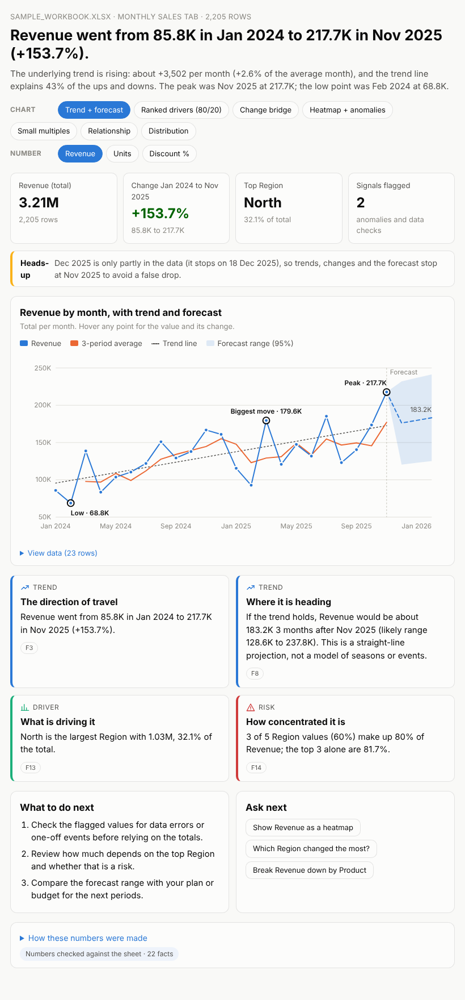
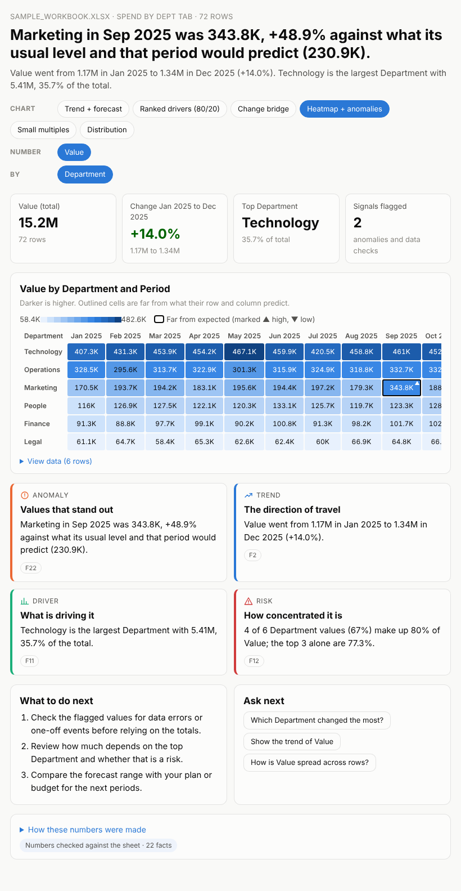

# Sheet Insights: spreadsheet to chart plus insight, in Gemini Enterprise

A proof-of-concept Gemini Enterprise (GE) agent. The user uploads an Excel or CSV file, picks a tab, picks
a chart style, and GE's side panel (A2UI Canvas) opens a dashboard: the chart **plus the story behind it**.
Built on the [eli5-a2ui](https://github.com/bmshambu/eli5-a2ui) boilerplate (Python ADK on Vertex AI
Agent Engine, A2UI v0.9).



## What it does that Excel doesn't

Excel draws the numbers you select. This agent reads the whole tab and works out what matters:

| | |
|---|---|
| **Trend + forecast** | trend line, 3-period rolling average, a 3-period forecast with a 95% range; peak, low and biggest move marked |
| **Ranked drivers (80/20)** | ranked bars with running share; the few items that make 80% of the total highlighted |
| **Change bridge** | waterfall from the first to the last period: how much each category added or took away |
| **Heatmap + anomalies** | category by period grid; cells far from what their row and column predict are flagged |
| **Small multiples** | one mini trend per category on a shared scale, each with its change |
| **Relationship** | scatter of two numbers with fit line, correlation and the furthest points labelled |
| **Distribution** | histogram with median, mean, middle half and unusual values |
| **Auto pick** | the view that tells the clearest story for this tab |

Around every chart: KPI tiles, a headline, 3 to 5 insight cards (trend, driver, risk, anomaly, pattern) each
citing the facts it rests on, what to do next, follow-up questions as one-click chips, a heads-up for data
problems, a "View data" table, and a PDF download.

Analysis it runs on every tab: growth and momentum, linear trend and how much it explains, forecast range,
typical period-to-period noise, seasonality, concentration (80/20 cut, HHI, long tail), what drove the change
between first and last period, fastest grower and biggest decliner, mix shift, rows far out of line with
their peers (robust z-score within each category combination), cells far from expected (two-way fit),
strongest correlation, spread and skew, missing and negative values.

It also tidies the sheet the way a person would: finds the header row under titles, drops "Total" rows so
nothing is double counted, reads `£1,200`, `(300)`, `12%`, `1.5k` as numbers, parses dates, months,
quarters and fiscal years, and turns wide tables (one column per month) into a time series. A last period
that is only partly in the data (daily rows that stop mid-month) is left out of trends and forecasts so it
doesn't look like a collapse.

## Numbers you can trust

The model never sees raw rows and never does arithmetic:

1. `analysis.py` (pandas) computes every figure and writes them as numbered facts (`F1 ...`).
2. One Gemini call writes the headline, insights, actions and questions from those facts, citing fact ids.
3. `llm.grounded()` checks every number in the text against the facts (same kind, within rounding of what
   was written). A claim that doesn't match is replaced by the facts it cites.
4. If the model call fails, `llm.fallback()` builds the narrative from the facts alone, so the dashboard
   still ships.

"How these numbers were made" at the bottom of the page lists every computed fact.

## Conversation flow

```
upload file ──► tab picker (skipped for one tab) ──► style picker ──► dashboard in the side panel
                                                                       │  chips: other style / number / breakdown
                                                                       │  "Ask next" chips and typed questions
                                                                       └  Download PDF · Pick another tab
```

Typed shortcuts work at any point: *"show revenue by product as a heatmap"*, *"use the Customers tab"*,
*"why did West fall?"* (re-tells the current chart's story around the question).

## Layout

| File | What |
|---|---|
| `agent/agent.py` | `root_agent`; routing per turn (actions, typed text, uploads), session state |
| `agent/sheets.py` | reading .xlsx/.csv from the GE turn, tidying, column roles (`profile`) |
| `agent/analysis.py` | facts, KPIs and chart data per style |
| `agent/charts.py` | the 7 chart styles as inline SVG/HTML |
| `agent/page.py` | the self-contained dashboard page (Canvas + IFrameSrcdoc) |
| `agent/llm.py`, `agent/schema.py` | the narrative call, number grounding, facts-only fallback |
| `agent/render.py` | A2UI cards: welcome, tab picker, style picker, dashboard, error |
| `agent/pdf.py` | the PDF report (reportlab) |
| `agent/a2ui.py`, `agent/validate.py`, `agent/schemas/` | from the boilerplate: v0.9 helpers and offline validation against the GE catalog |
| `agent/probe*.py`, `PROBE.md` | from the boilerplate: `AGENT_MODE=probe` tenant probe |
| `samples/sample_workbook.xlsx` | three tabs that exercise every style (`python tools/make_sample.py` rebuilds it) |

## Run the tests

```
python -m venv .venv && .venv\Scripts\activate      (Windows)   or   source .venv/bin/activate
pip install -r requirements.txt
python -m pytest tests -q
```

The tests use a fake model client, so they run offline. Every reply is validated against the pinned GE
composite catalog (`validate.check`).

## Deploy

1. `copy env.dev.example .env.dev` and fill in the project, region and staging bucket. Keep the distinct
   `AGENT_DISPLAY_NAME`: deploy matches on it, so reusing ELI5's would overwrite that agent.
2. `gcloud auth application-default login`
3. `python deploy_to_agent_engine.py`
4. GE Admin console, Agents, Add agent, Vertex AI Agent Engine, paste the `projects/.../reasoningEngines/...` name.

Judge rendering only in GE chat: the Agent Engine Playground and `adk web` show raw JSON. Pins in
`requirements.txt` and `deploy_to_agent_engine.py` must match (see the boilerplate notes).

## Not proven yet in GE

- How GE delivers an uploaded .xlsx (the agent expects `inline_data` bytes, as PDFs and Word files arrived
  for ELI5). The logs show `turn parts: [...]` each turn; if GE sends a `file_data` URI instead, the agent
  needs a download step.
- The dashboard is about 25 to 70 KB per page, well under the ~1 MB card limit.
- First run should be with F12 open to confirm chips inside the frame reach the agent (proven for ELI5).


